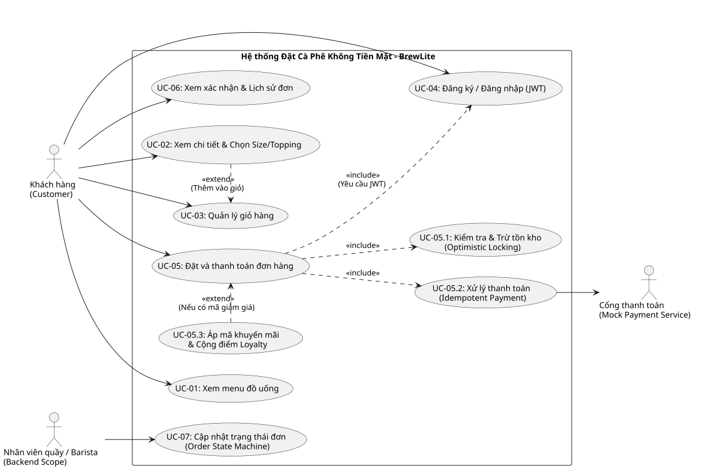
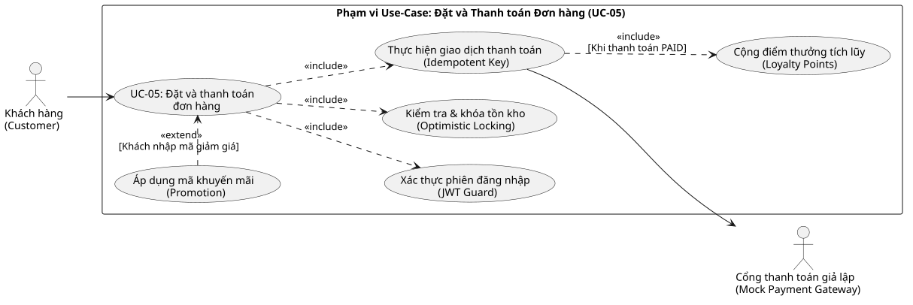
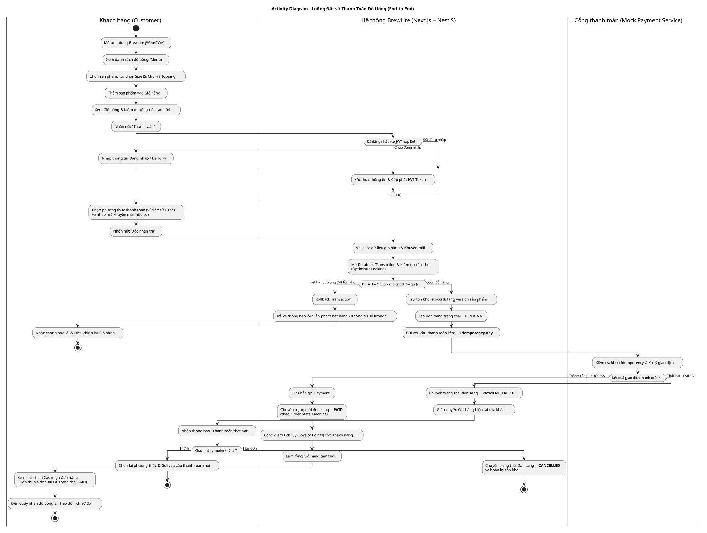
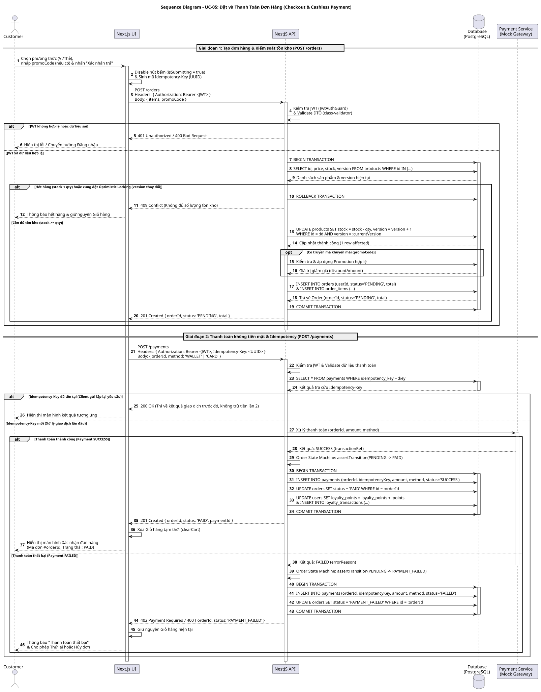
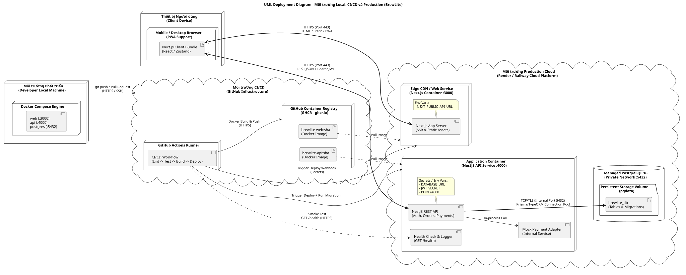

# Mô hình hóa Hệ thống (System Modeling Diagrams) – BrewLite

Thư mục này lưu trữ toàn bộ mã nguồn PlantUML (`.puml`) và hình ảnh kết xuất (`.svg`) của hệ thống BrewLite, đảm bảo tính nhất quán với tài liệu SRS và đặc tả Use-case.

## 1. Use-Case Diagrams (Task 1)
### 1.1. Sơ đồ Use-Case Tổng quát
- File nguồn: [uc-overview.puml](./uc-overview.puml)

### 1.2. Sơ đồ Use-Case Trọng tâm (Đặt & Thanh toán đơn hàng)
- File nguồn: [uc-checkout-payment.puml](./uc-checkout-payment.puml)

---

## 2. Activity Diagram – Luồng End-to-End có Swimlane (Task 2.1)
- File nguồn: [activity-order-flow.puml](./activity-order-flow.puml)
- File ảnh: [activity-order-flow.svg](./activity-order-flow.svg)

---

## 3. Sequence Diagram – Đặt và Thanh toán Đơn hàng (Task 2.2)
- File nguồn: [sequence-checkout.puml](./sequence-checkout.puml)
- File ảnh: [sequence-checkout.svg](./sequence-checkout.svg)

---

## 4. Domain Class Diagram (Task 2.3)
- File nguồn: [class-domain.puml](./class-domain.puml)
- File ảnh: [class-domain.svg](./class-domain.svg)

---

## 5. UML Deployment Diagram (Task 3.2)
- File nguồn: [deployment.puml](./deployment.puml)
- File ảnh: [deployment.svg](./deployment.svg)

